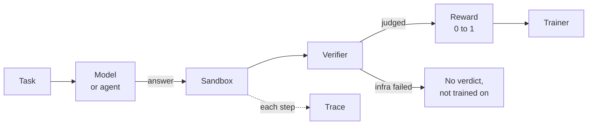

# DeepGym

[](https://pypi.org/project/deepgym/)
[](https://github.com/DeepGym/deepgym/actions/workflows/deepgym-ci.yml)
[](https://github.com/DeepGym/deepgym/blob/main/LICENSE)

**Build RL environments and record agent traces, with rewards that hold up against
shortcut answers and infrastructure failures.**

DeepGym is a Python library for teams that build gyms and trace datasets, and for
researchers who train models on them.

Take the coin-change task in the quickstart below. The answer `return -1` passes 3 of its
25 cases, so a verifier that pays partial credit gives it 0.12, and a policy trained on
that reward learns to collect it. A policy that can read the verifier's files has a
shorter route: print the expected output. Outages do damage too. When a sandbox dies
mid-run, the 0 it leaves lands in the group baseline and pushes the policy away from an
answer that may have been right.

DeepGym runs each answer in a sandbox, apart from the verifier wherever the task allows,
and gives a run no verdict when the infrastructure failed rather than the policy, so that
run stays out of training. Before you train, `deepgym qa` attacks each environment with
answers that should earn nothing (empty, stubbed or reward-hacking ones, depending on the
task) and fails it if any of them earns reward. The rewards
then go to verl, TRL, OpenRLHF, Axolotl or lm-evaluation-harness, and agent episodes are
recorded as traces with their provenance.

## Quickstart

```bash
pip install deepgym
```

Score a correct and a wrong answer to a built-in task. It runs locally with no account or
API key. Linux needs `bubblewrap` installed:

```python
from deepgym import DeepGym, load_environment

dg = DeepGym(mode='local')
env = load_environment('coin_change')

solution = '''
def coin_change(coins, amount):
    dp = [float('inf')] * (amount + 1)
    dp[0] = 0
    for coin in coins:
        for x in range(coin, amount + 1):
            dp[x] = min(dp[x], dp[x - coin] + 1)
    return dp[amount] if dp[amount] != float('inf') else -1
'''
wrong = 'def coin_change(coins, amount):\n    return -1\n'

batch = dg.run_batch(env, [solution, wrong])
for r in batch.results:
    print(r.score, r.passed, r.has_verdict, r.metrics)
# 1.0 True True {'pass_fraction': 1.0}
# 0.0 False True {'pass_fraction': 0.12}
```

Built-ins pay 1.0 only when every case passes, so the wrong answer scores 0. The share of
cases it passed stays in `metrics`, and each case's result is in `r.cases`.

`mode='local'` runs the answer under `sandbox-exec` (macOS) or `bwrap` (Linux) and is for
development. Without either, local runs refuse unless you set
`DEEPGYM_ALLOW_UNSANDBOXED=1`. On macOS the answer can still read the environment
variables of the shell that started DeepGym, and DeepGym warns, naming the ones that look
like keys.

Your own environment starts from a template that already passes every check:

```bash
deepgym new word_stats --kind function   # or script, repo-patch, multi-turn
deepgym check word_stats                 # the reference passes, empty and stub answers fail
deepgym qa word_stats                    # determinism, reward-hack attacks, your controls
```

Or define one in code. The verifier reaches the answer only through the
`deepgym_solution` helpers:

```python
from deepgym import Environment

env = Environment(
    task='Write a function `add(a, b)` that returns the sum of two numbers.',
    verifier_code=(
        'from deepgym_solution import load_solution\n'
        'sol = load_solution(solution_path)\n'
        'return 1.0 if hasattr(sol, "add") and sol.add(2, 3) == 5 else 0.0\n'
    ),
)
result = dg.run(env, model_output='def add(a, b):\n    return a + b\n')
print(result.score)   # 1.0
```

## Training

In training the answers come from a policy you don't trust, so they run in a sandbox
provider: Docker, Apple container, Daytona, Modal or E2B. Not every task runs on every
provider. Desktop tasks, OSWorld included, need Daytona, and SWE-bench Pro and
Terminal-Bench 2.0 need a sandbox with network, such as Daytona. With TRL and Docker:

```python
from datasets import Dataset
from trl import GRPOConfig, GRPOTrainer

from deepgym import DeepGym, load_environment
from deepgym.integrations.trl import make_trl_reward_fn

env = load_environment('coin_change')
reward_fn = make_trl_reward_fn(env, DeepGym(mode='docker'))   # or daytona, modal, e2b

trainer = GRPOTrainer(
    model='Qwen/Qwen2.5-0.5B-Instruct',
    reward_funcs=[reward_fn],
    args=GRPOConfig(output_dir='grpo-coin-change'),
    train_dataset=Dataset.from_list([{'prompt': env.task}] * 64),
)
trainer.train()
```

The snippet repeats one task to show the wiring. `MixedEnvironment` puts SWE-bench Pro,
Terminal-Bench 2.0 and built-ins behind one reward function and sends each completion to
the environment its row's `env_name` names ([TRL][trl]). A completion whose sandbox or
verifier failed gets `None`. TRL 1.6+ leaves a completion out of the group's baseline only
when every reward function returned `None` for it, so a format reward added beside this
one keeps it in.

verl loads the same scoring from its config, with each dataset row naming its environment
(`verl_rows(['coin_change', 'two_sum'])` writes them). Its v1 trainer drops a sample
without a verdict instead of scoring it:

```yaml
reward:
  custom_reward_function:
    path: pkg://deepgym.integrations.verl
    name: compute_score
    reward_kwargs: {mode: daytona}
```

The [examples][examples] cover OpenRLHF, lm-evaluation-harness, multi-turn sessions,
computer-use agents, Claude Code and Codex in the sandbox, traces, and benchmark imports.

## Why the rewards hold up



- A single-file answer never runs inside its verifier. Verifiers reach it through the
  `deepgym_solution` helpers, which start it in a separate process with no network (as
  another Linux user in a sandbox provider, under `sandbox-exec` or `bwrap` locally) and
  pass back only plain data, so it can't read the expected outputs, print a fake score or
  patch the verifier.
- Repo-patch tasks (SWE-bench Pro, MiMo), Harbor tasks and BigCodeBench run the answer's
  code next to the tests. There the sandbox, the test-infrastructure guard and a fresh
  grading sandbox do the isolating, and the reward is only as strong as the tests
  ([importers][importers]).
- Infrastructure failures are not scored. When the provider or network fails, or the
  sandbox or verifier fails before the answer is in play, `dg.run` raises, and
  `run_batch`, `eval` and the trainer reward functions return the run without a verdict
  (`has_verdict` is false). The trainer integrations keep it out of training where the
  trainer allows.
- Failures the policy causes are scored. Failing tests, a malformed patch, a patch that
  touches test infrastructure, an answer that crashes or hangs the verifier, and a sandbox
  the agent killed all score 0, and a score printed before a crash is never kept.
- Masking has a cost: a policy can learn to trigger failures that look like
  infrastructure and escape the penalty. `RewardFunction`, the TRL, Axolotl and DAPO
  reward functions, the OpenRLHF endpoint, the verl agent loops and `RubricReward` warn
  when more than 5 in 100 samples get no verdict. verl's `compute_score` and the lm-eval
  tasks don't.
- `deepgym qa` fails an environment whose reference doesn't score 1.0 on every rerun, or
  whose empty, stub or reward-hack answers earn anything above float noise. It also runs
  the controls you ship, mutants of the reference (`--mutants`) and a pass@k difficulty
  probe against your model (`--model`).
- `deepgym qa --approve` stores the report with a hash of every file, and `deepgym check`
  fails once the folder changes.
- In a rubric for an LLM judge, an unmet `must` check or a met `fatal` check scores the
  answer 0 whatever else it got right. A judge reply that was refused, cut off or
  malformed gets no verdict. `calibrate` measures the judge against expert labels (TPR,
  TNR, Cohen's kappa) before you rely on it.
- DeepGym stops every process a CLI agent started before grading, and grades a Harbor task
  in a fresh sandbox from a copy of its work directory.
- Batch and eval totals still count a run without a verdict as a failed 0, so an outage
  can only lower a pass rate, and print the judged-only numbers beside them.

The rules are in [the reward contract][reward-contract], [the QA gate][qa-gate] and
[rubric-judged rewards][rubric].

## What ships

| Area | Included |
|---|---|
| Environments | 31 built-ins: 22 coding, 5 computer-use desktops with 8 seeded variants each, 2 tool-use, 2 cyber ([list][built-ins]). Single-turn, multi-turn (one live sandbox per episode, from Python or over HTTP) and computer use (screenshots in, mouse and keyboard out, scored on the state the agent leaves) |
| Benchmarks | SWE-bench Pro, Terminal-Bench 2.0 and any other Harbor dataset, BigCodeBench, HumanEval, MBPP, EvalPlus, MiMo-V2.6-RL code tasks, CyberGym, and 16 OSWorld LibreOffice tasks ([importers][importers]); `MixedEnvironment` puts several behind one reward function |
| Sandboxes | Docker, Apple container, Daytona (cloud or self-hosted), Modal and E2B; `local` for development. Desktop tasks need Daytona ([sandboxes][sandboxes]) |
| Agents | Claude Code and Codex CLI inside the sandbox, Anthropic and OpenAI computer-use and API tool agents, with turn, time and cost budgets ([agents][agents]) |
| Training and eval | [verl][verl] (reward function and agent loops), [TRL][trl], [OpenRLHF][openrlhf], [Axolotl][axolotl], [lm-evaluation-harness][lm-eval], `RewardFunction` for your own loop, and a Gymnasium-style `reset`/`step` API |
| Authoring | `deepgym new`, `check` and `qa`, controls, mutation testing and approvals ([authoring][authoring], [verifiers][verifiers]); Hugging Face Hub sharing |
| Traces | Recorded with provenance, token usage and cost; exported as JSONL, Parquet rows for verl and TRL, or ATIF ([traces][traces]) |
| Analysis | Two runs compared task by task with pass@k, pass^k and an exact significance test; scanners for behaviour the verifier missed; versioned datasets with splits by prompt and a manifest hash ([compare][compare], [scanners][scan-traces], [datasets][datasets]) |
| Review | Labels on runs, episodes, traces and single steps; review queues for expert reviewers, blind by default; judge calibration from stored labels ([labels][labels], [review queues][review-queues], [console][console]) |
| Serving | `deepgym serve`, an HTTP API with jobs and live sessions ([API server][api-server]); `deepgym console`, a local web console for environments, runs, episode replay, sandboxes and QA reports ([console][console]) |

## Agents and traces

An episode is one agent working through a multi-turn task in a sandbox. `dg.trace()`
records it while it runs, one event per line under `~/.deepgym/traces/` (or
`$DEEPGYM_TRACES_DIR`), so a crash or a killed process keeps the steps taken so far. Here
Claude Code works on a task inside the sandbox:

```python
from deepgym import DeepGym
from deepgym.agents import Budget, ClaudeCodeAgent
from deepgym.traces import AgentMeta

dg = DeepGym(mode='daytona')
# allow_model_credentials: the CLI, and so the model, can read the provider API key
agent = ClaudeCodeAgent(model='claude-opus-5-5', allow_model_credentials=True)

# env: a MultiTurnEnvironment whose image has the Claude Code CLI, with 'cli' in
# allowed_actions and cli_provider_egress=True (see the examples)
with dg.trace(env, AgentMeta(name='claude-code', model='claude-opus-5-5')) as tr:
    agent.run(tr, tr.start(), task=env.task,
              budget=Budget(max_turns=None, max_seconds=4 * 3600))  # CLI runs need a deadline
    tr.score()

print(tr.trace.has_verdict, tr.trace.usage, tr.trace.cost_usd)
```

The CLI runs headless as an unprivileged user, and its network reaches only the provider's
hostname on port 443. `CodexAgent` works the same way. The Anthropic and OpenAI
computer-use and API tool agents drive the sandbox from the host ([agents][agents]). What
lands in the trace depends on the agent:

| Agent | Records |
|---|---|
| API tool agents | Each step's model messages, token usage and cost |
| Computer-use agents | Each step's token usage and cost, no messages |
| Claude Code, Codex | One step holding the CLI's own events (tool calls, edits, output), and the run's token usage and cost when it ends; no model messages |
| Your own loop | What you pass to `tr.step(action, messages, usage=..., cost_usd=...)` |

A trace holds:

- **Provenance:** SHA-256 hashes of the environment, task, verifiers and reference, the
  image digest the sandbox booted from, the deepgym version and git commit, and the agent,
  model and sampling config you passed.
- **Every step:** the action, the model messages behind it when the agent records them
  (with token ids and logprobs if you have them), token usage and USD cost, what came back,
  and the step reward.
- **The verdict,** with every earlier `score()` result kept. Usage or cost that a provider
  never reported stays null, never 0, and `usage_complete` says whether any is missing.

Export them as training data:

```bash
deepgym traces export --format jsonl --out traces.jsonl             # whole traces
deepgym traces export --format parquet --rows rl --out rl.parquet   # verl / TRL rows
deepgym traces export --format atif --out atif/ --only-valid        # ATIF documents
```

A trace without a verdict is exported with `has_verdict: false` and its RL row gets a null
reward; `--only-valid` leaves it out. `--rows rl` needs the model messages of every turn,
so it skips computer-use, Claude Code and Codex runs. Details are in [traces][traces].

## Compare two runs

Base model against a checkpoint, or one agent against another, on the same tasks. Give
each run its own `DEEPGYM_TRACES_DIR` and load the folders:

```python
from pathlib import Path

from deepgym.compare import attempts_from_traces, compare
from deepgym.traces import load_trace

base = [load_trace(p) for p in Path('runs/base').glob('*.jsonl')]
tuned = [load_trace(p) for p in Path('runs/step-400').glob('*.jsonl')]

report = compare(attempts_from_traces(base), attempts_from_traces(tuned))
print(report.flips)          # task count per flip
print(report.significance)   # exact test: p_value, b_better, a_better, ties
for task in report.tasks:
    if task.flip == 'regressed':
        print(task.key, task.a.solve_rate, task.b.solve_rate)
```

- Each task gets its solve rate (pass@1) and mean score on both sides, and a flip:
  improved, regressed, both solved, both failed, or mixed (a side solved only some of its
  attempts).
- Each side gets mean pass@k and pass^k (all k attempts pass), and a count of tasks the
  model never solves, always solves, or solves some of the time.
- The p-value comes from an exact permutation test stratified by task, so it stays valid
  when tasks have different attempt counts. With one attempt per task it equals exact
  McNemar.
- An attempt without a verdict counts in no rate. A task whose environment changed between
  the runs (its verifier edited, say) is listed as `changed` and left out, so a new
  checkpoint is never compared against an old verifier.

`deepgym.passk` has the estimators on their own: `pass_at_k(n, c, k)`, `pass_hat_k(n, c,
k)` and `task_difficulty(n, c)`.

## Find what the verifier missed

A verifier checks the state the agent leaves. It doesn't see an agent that edited the tests
on the way there, or skipped the one that kept failing. Scanners read the trace for that:

```python
from deepgym.scanners import PatternScanner, ProtectedPathScanner, group_findings, scan_traces

scanners = [
    ProtectedPathScanner(name='protected', globs=('tests', 'conftest.py')),
    PatternScanner(name='skips', patterns=[
        {'regex': r'pytest\.skip|@unittest\.skip', 'message': 'Skips a test', 'severity': 'high'},
    ]),
]
report = scan_traces(traces, scanners)   # traces: loaded with load_trace, as above
for group in group_findings(report.findings):
    print(group.scanner, group.message, len(group.findings), group.traces)
```

```bash
deepgym traces scan --config scanners.json --out report.json --write-labels
```

- Each finding cites its trace and step, and quotes the text where the action has it; for
  file writes and CLI edits the message names the path instead.
- `ProtectedPathScanner` reads shell commands, Python file writes and Claude Code and Codex
  edits without running anything. It only knows the write patterns [listed in the
  docs][scan-traces], so diff the final workspace when you need every changed file.
- `PatternScanner` matches your regexes in actions, observations or messages. It doesn't
  see a CLI agent's own tool calls.
- `LLMScanner` (Python only) has a judge model read each trace with your instruction.
- A scanner that fails on a trace is reported as an error for that trace, never as clean,
  and the CLI exits 3.
- `--write-labels` stores a label for every finding and every scan error, so a dataset
  build can drop flagged traces and the ones no scanner cleared.

## Expert review and judge calibration

A label is one judgment about a run, episode or trace, or one step or quoted span of it.
It comes from a verifier, an LLM judge or an expert, and an expert's label carries the
reason. Labels are an append-only log, so a correction supersedes the old label instead
of overwriting it ([labels][labels]).

Review queues hand items to experts. Each item gets `overlap` reviews from different
people, and reservations never hand it to more reviewers than that. In a blind queue (the
default) a reviewer sees no one else's label, the verifier's and judge's included, until
they submit. That covers only what the queue routes return. The local console has no
login, so anyone can review under another name or read grades from other routes; a shared
setup must put reviewers behind a login that reaches only the queue routes
([review queues][review-queues]).

```python
from deepgym.console import record_episode
from deepgym.console.db import DEFAULT_DB_PATH
from deepgym.console.queue_store import QueueStore
from deepgym.labels import LabelTarget
from deepgym.review_queues import ItemCreate, QueueCreate, ReviewLabel

queues = QueueStore(DEFAULT_DB_PATH)
queue = queues.create(QueueCreate(
    name='judge v3 calibration', instructions='Pass only if the config is fixed.',
    label_names=('passed',), overlap=3, blind=True,
))
for t in traces:
    record_episode(t)   # stores the trace, so the queue can show it to reviewers
trace_ids = [t.trace_id for t in traces]
queues.add_items(queue.id, [ItemCreate(target=LabelTarget(kind='trace', id=t)) for t in trace_ids])

view = queues.next_item(queue.id, 'ana')                  # None once nothing is left for ana
content = queues.content(queue.id, view.item.id, 'ana')   # task, answer and steps, no grades
queues.submit(queue.id, view.item.id, 'ana', [
    ReviewLabel(name='passed', value=False, comment='Opens port 80 instead of fixing the config.'),
])
```

Before you train on an LLM judge's reward, run `calibrate`. It has the judge grade
expert-labeled answers several times and reports TPR, TNR, Cohen's kappa and the judge's
agreement with itself, beside the experts' agreement with each other. Pass the ids of the
answers you wrote the rubric from as `built_from`: if any is among the labeled answers, it
raises before calling the judge. `report.meets(min_tpr=0.9, min_tnr=0.9)` gives a pass or
fail you can put in CI. The console computes the same
numbers from stored labels, without calling the judge ([rubric judge][rubric],
[console][console]).

## Build a dataset

`deepgym.dataset` turns traces and their labels into a versioned dataset with train, val
and test splits:

```python
from pathlib import Path

from deepgym.console.db import DEFAULT_DB_PATH
from deepgym.console.episode_store import read_trace_ids
from deepgym.console.label_store import read_labels
from deepgym.dataset import DatasetSpec, build_dataset, write_dataset
from deepgym.scanners import scanner_forbids

spec = DatasetSpec(
    models=('Qwen/Qwen3-8B',),
    bands=('learnable',), inside_band=True,          # tasks solved 10 to 90% of the time
    forbid_labels=scanner_forbids('protected', source='verifier'),
    max_cost_usd=0.5,
)
dataset = build_dataset(traces, spec, read_labels(DEFAULT_DB_PATH), read_trace_ids(DEFAULT_DB_PATH))
print(dataset.counts)    # kept, per split, dropped per reason
sha256 = write_dataset(dataset, Path('notes-v1'), name='notes', version='1.0.0',
                       formats=['jsonl', 'parquet'])
```

```bash
deepgym dataset build --spec spec.json --name notes --version 1.0.0 --out notes-v1 \
    --format jsonl parquet
deepgym dataset verify notes-v1 --sha256 <the sha256 build printed>
```

- Copies of one trajectory ship once. Human `passed` labels on any copy are pooled and
  override the verifier. When humans disagree, every copy is dropped as `contested`; when
  the verifier passed some copies and failed others and no human judged them, every copy
  is dropped as `inconsistent`.
- Splits go by a hash of the prompt, so one prompt never lands in both train and test, and
  adding prompts later never moves an existing one.
- Every dropped trace is listed under the reason it was dropped. By default a trace without
  a verdict is dropped as `no_verdict`, never kept as a fail.
- `manifest.json` pins every file by SHA-256. Publish the manifest's own hash, and
  `deepgym dataset verify` checks a downloaded copy against it, file by file.

## The console

`deepgym console` is a local web app over the same database: browse environments, score
solutions on any provider, replay episodes step by step with screenshots, and read QA
reports. Traces stored with `record_episode(tr.trace)`, labels, review queues, scans,
datasets and judge agreement also have REST routes, so you can build your own review tool
or dashboard on top:

| Route | What it does |
|---|---|
| `/api/runs`, `/api/runs/compare` | Score solutions in the background; compare two run groups |
| `/api/traces` | List stored traces with their verdicts; read one with every step |
| `/api/labels` | Add, correct, retract and query labels |
| `/api/queues` | Review queues: next item, its content with grades hidden, submit, skip, progress |
| `/api/scans` | Run rule scanners over stored traces |
| `/api/datasets` | Build, list and verify datasets |
| `/api/calibration/agreement` | A judge's stored verdicts against the experts' |

```bash
pip install "deepgym[server]"
deepgym console --port 8080   # http://127.0.0.1:8080
```

It binds to `127.0.0.1` by default, and every API call needs the per-launch token the
console writes into its pages. `--ui-dir` serves your own UI build in place of the bundled
one ([console][console]).

## Install

Python 3.10 or later. Optional extras:

| Extra | Adds |
|---|---|
| `deepgym[daytona]`, `deepgym[modal]`, `deepgym[e2b]` | Those sandbox providers |
| `deepgym[server]` | `deepgym serve` and `deepgym console` |
| `deepgym[hf]` | Hugging Face Hub sharing and dataset loaders |
| `deepgym[lm_eval]` | lm-evaluation-harness tasks |
| `deepgym[traces]` | Parquet trace export |
| `deepgym[anthropic]`, `deepgym[openai]` | The built-in computer-use and API tool agents; `[anthropic]` also the Anthropic rubric judge |
| `deepgym[all]` | Everything above except `lm_eval` and the agent extras |

## Documentation

- [Core concepts][concepts]: how a run moves through environment, sandbox, verifier and
  trainer
- [Examples][examples]: every integration and workflow as code
- [CLI reference][cli]: every `deepgym` command and its main flags
- Environments: [built-ins][built-ins], [importers][importers], [sessions][sessions],
  [computer use][computer-use]
- Authoring: [new, check, qa][authoring], [verifiers][verifiers], [the QA gate][qa-gate],
  [approvals][approvals]
- Training: [the reward contract][reward-contract], [rubric judge][rubric], [verl][verl],
  [TRL][trl], [OpenRLHF][openrlhf], [Axolotl][axolotl], [lm-eval][lm-eval]
- Running: [sandboxes][sandboxes], [agents][agents], [console][console],
  [API server][api-server]
- Traces and data: [record and export][traces], [compare][compare],
  [scanners][scan-traces], [datasets][datasets], [labels][labels],
  [review queues][review-queues]

## For teams and labs

DeepGym is free for personal, research and other noncommercial use. Commercial use,
including inside a company or in a product you sell, needs a commercial license. We also
build private environments and verifiers for your tasks, deploy DeepGym privately or
self-hosted, and help set up and run RL training. For DeepGym Pro access or a custom RL
environment, email [contact@deepgym.io](mailto:contact@deepgym.io) or visit
[deepgym.io](https://deepgym.io).

## Contributing

New environments, verifiers, benchmark importers and integrations are all welcome. Start
with a [good first issue](https://github.com/DeepGym/deepgym/issues?q=is%3Aissue+is%3Aopen+label%3A%22good+first+issue%22)
and see [CONTRIBUTING.md](https://github.com/DeepGym/deepgym/blob/main/.github/CONTRIBUTING.md)
for setup, tests and releases.

## License

[PolyForm Noncommercial License 1.0.0](https://github.com/DeepGym/deepgym/blob/main/LICENSE).
Commercial use needs a license: [contact@deepgym.io](mailto:contact@deepgym.io).

[examples]: https://github.com/DeepGym/deepgym/blob/main/deepgym/docs/examples.md
[concepts]: https://github.com/DeepGym/deepgym/blob/main/deepgym/docs/concepts.md
[reward-contract]: https://github.com/DeepGym/deepgym/blob/main/deepgym/docs/training/reward-contract.md
[rubric]: https://github.com/DeepGym/deepgym/blob/main/deepgym/docs/training/rubric-judge.md
[built-ins]: https://github.com/DeepGym/deepgym/blob/main/deepgym/docs/environments/built-ins.md
[importers]: https://github.com/DeepGym/deepgym/blob/main/deepgym/docs/environments/importers.md
[computer-use]: https://github.com/DeepGym/deepgym/blob/main/deepgym/docs/environments/computer-use.md
[sessions]: https://github.com/DeepGym/deepgym/blob/main/deepgym/docs/environments/sessions.md
[agents]: https://github.com/DeepGym/deepgym/blob/main/deepgym/docs/agents.md
[authoring]: https://github.com/DeepGym/deepgym/blob/main/deepgym/docs/authoring/new-check-qa.md
[verifiers]: https://github.com/DeepGym/deepgym/blob/main/deepgym/docs/authoring/verifiers.md
[qa-gate]: https://github.com/DeepGym/deepgym/blob/main/deepgym/docs/authoring/qa-gate.md
[approvals]: https://github.com/DeepGym/deepgym/blob/main/deepgym/docs/authoring/approvals.md
[verl]: https://github.com/DeepGym/deepgym/blob/main/deepgym/docs/training/verl.md
[trl]: https://github.com/DeepGym/deepgym/blob/main/deepgym/docs/training/trl.md
[openrlhf]: https://github.com/DeepGym/deepgym/blob/main/deepgym/docs/training/openrlhf.md
[lm-eval]: https://github.com/DeepGym/deepgym/blob/main/deepgym/docs/training/lm-eval.md
[axolotl]: https://github.com/DeepGym/deepgym/blob/main/deepgym/docs/training/axolotl.md
[traces]: https://github.com/DeepGym/deepgym/blob/main/deepgym/docs/traces.md
[compare]: https://github.com/DeepGym/deepgym/blob/main/deepgym/docs/compare.md
[scan-traces]: https://github.com/DeepGym/deepgym/blob/main/deepgym/docs/scanners.md
[datasets]: https://github.com/DeepGym/deepgym/blob/main/deepgym/docs/datasets.md
[labels]: https://github.com/DeepGym/deepgym/blob/main/deepgym/docs/labels.md
[review-queues]: https://github.com/DeepGym/deepgym/blob/main/deepgym/docs/review-queues.md
[sandboxes]: https://github.com/DeepGym/deepgym/blob/main/deepgym/docs/sandboxes.md
[cli]: https://github.com/DeepGym/deepgym/blob/main/deepgym/docs/cli.md
[api-server]: https://github.com/DeepGym/deepgym/blob/main/deepgym/docs/api-server.md
[console]: https://github.com/DeepGym/deepgym/blob/main/deepgym/docs/console.md
