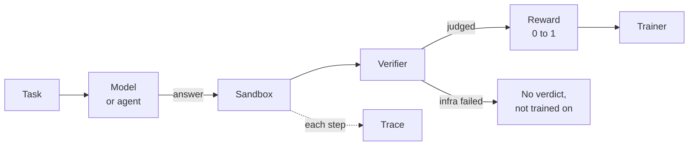

# DeepGym

[](https://pypi.org/project/deepgym/)
[](https://github.com/DeepGym/deepgym/actions/workflows/deepgym-ci.yml)
[](https://github.com/DeepGym/deepgym/blob/main/LICENSE)

**Build RL environments and record agent traces, with rewards that hold up against
shortcut answers and infrastructure failures.**

DeepGym is a Python library for teams that build gyms and trace datasets, and for
researchers who train models on them.

Take the coin-change task in the quickstart below. The answer `return -1` passes 3 of its
25 cases, so a verifier that pays partial credit gives it 0.12, and a policy trained on
that reward learns to collect it. A policy that can read the verifier's files has a
shorter route: print the expected output. Outages do damage too. When a sandbox dies
mid-run, the 0 it leaves lands in the group baseline and pushes the policy away from an
answer that may have been right.

DeepGym runs each answer in a sandbox, apart from the verifier wherever the task allows,
and gives a run no verdict when the infrastructure failed rather than the policy, so that
run stays out of training. Before you train, `deepgym qa` attacks each environment with
answers that should earn nothing (empty, stubbed or reward-hacking ones, depending on the
task) and fails it if any of them earns reward. The rewards
then go to verl, TRL, OpenRLHF, Axolotl or lm-evaluation-harness, and agent episodes are
recorded as traces with their provenance.

## Quickstart

```bash
pip install deepgym
```

Score a correct and a wrong answer to a built-in task. It runs locally with no account or
API key. Linux needs `bubblewrap` installed:

```python
from deepgym import DeepGym, load_environment

dg = DeepGym(mode='local')
env = load_environment('coin_change')

solution = '''
def coin_change(coins, amount):
    dp = [float('inf')] * (amount + 1)
    dp[0] = 0
    for coin in coins:
        for x in range(coin, amount + 1):
            dp[x] = min(dp[x], dp[x - coin] + 1)
    return dp[amount] if dp[amount] != float('inf') else -1
'''
wrong = 'def coin_change(coins, amount):\n    return -1\n'

batch = dg.run_batch(env, [solution, wrong])
for r in batch.results:
    print(r.score, r.passed, r.has_verdict, r.metrics)
# 1.0 True True {'pass_fraction': 1.0}
# 0.0 False True {'pass_fraction': 0.12}
```

Built-ins pay 1.0 only when every case passes, so the wrong answer scores 0. The share of
cases it passed stays in `metrics`, and each case's result is in `r.cases`.

`mode='local'` runs the answer under `sandbox-exec` (macOS) or `bwrap` (Linux) and is for
development. Without either, local runs refuse unless you set
`DEEPGYM_ALLOW_UNSANDBOXED=1`. On macOS the answer can still read the environment
variables of the shell that started DeepGym, and DeepGym warns, naming the ones that look
like keys.

Your own environment starts from a template that already passes every check:

```bash
deepgym new word_stats --kind function   # or script, repo-patch, multi-turn
deepgym check word_stats                 # the reference passes, empty and stub answers fail
deepgym qa word_stats                    # determinism, reward-hack attacks, your controls
```

Or define one in code. The verifier reaches the answer only through the
`deepgym_solution` helpers:

```python
from deepgym import Environment

env = Environment(
    task='Write a function `add(a, b)` that returns the sum of two numbers.',
    verifier_code=(
        'from deepgym_solution import load_solution\n'
        'sol = load_solution(solution_path)\n'
        'return 1.0 if hasattr(sol, "add") and sol.add(2, 3) == 5 else 0.0\n'
    ),
)
result = dg.run(env, model_output='def add(a, b):\n    return a + b\n')
print(result.score)   # 1.0
```

## Training

In training the answers come from a policy you don't trust, so they run in a sandbox
provider: Docker, Apple container, Daytona, Modal or E2B. Not every task runs on every
provider. Desktop tasks, OSWorld included, need Daytona, and SWE-bench Pro and
Terminal-Bench 2.0 need a sandbox with network, such as Daytona. With TRL and Docker:

```python
from datasets import Dataset
from trl import GRPOConfig, GRPOTrainer

from deepgym import DeepGym, load_environment
from deepgym.integrations.trl import make_trl_reward_fn

env = load_environment('coin_change')
reward_fn = make_trl_reward_fn(env, DeepGym(mode='docker'))   # or daytona, modal, e2b

trainer = GRPOTrainer(
    model='Qwen/Qwen2.5-0.5B-Instruct',
    reward_funcs=[reward_fn],
    args=GRPOConfig(output_dir='grpo-coin-change'),
    train_dataset=Dataset.from_list([{'prompt': env.task}] * 64),
)
trainer.train()
```

The snippet repeats one task to show the wiring. `MixedEnvironment` puts SWE-bench Pro,
Terminal-Bench 2.0 and built-ins behind one reward function and sends each completion to
the environment its row's `env_name` names ([TRL][trl]). A completion whose sandbox or
verifier failed gets `None`. TRL 1.6+ leaves a completion out of the group's baseline only
when every reward function returned `None` for it, so a format reward added beside this
one keeps it in.

verl loads the same scoring from its config, with each dataset row naming its environment
(`verl_rows(['coin_change', 'two_sum'])` writes them). Its v1 trainer drops a sample
without a verdict instead of scoring it:

```yaml
reward:
  custom_reward_function:
    path: pkg://deepgym.integrations.verl
    name: compute_score
    reward_kwargs: {mode: daytona}
```

The [examples][examples] cover OpenRLHF, lm-evaluation-harness, multi-turn sessions,
computer-use agents, Claude Code and Codex in the sandbox, traces, and benchmark imports.

## Why the rewards hold up



- A single-file answer never runs inside its verifier. Verifiers reach it through the
  `deepgym_solution` helpers, which start it in a separate process with no network (as
  another Linux user in a sandbox provider, under `sandbox-exec` or `bwrap` locally) and
  pass back only plain data, so it can't read the expected outputs, print a fake score or
  patch the verifier.
- Repo-patch tasks (SWE-bench Pro, MiMo), Harbor tasks and BigCodeBench run the answer's
  code next to the tests. There the sandbox, the test-infrastructure guard and a fresh
  grading sandbox do the isolating, and the reward is only as strong as the tests
  ([importers][importers]).
- Infrastructure failures are not scored. When the provider or network fails, or the
  sandbox or verifier fails before the answer is in play, `dg.run` raises, and
  `run_batch`, `eval` and the trainer reward functions return the run without a verdict
  (`has_verdict` is false). The trainer integrations keep it out of training where the
  trainer allows.
- Failures the policy causes are scored. Failing tests, a malformed patch, a patch that
  touches test infrastructure, an answer that crashes or hangs the verifier, and a sandbox
  the agent killed all score 0, and a score printed before a crash is never kept.
- Masking has a cost: a policy can learn to trigger failures that look like
  infrastructure and escape the penalty. `RewardFunction`, the TRL, Axolotl and DAPO
  reward functions, the OpenRLHF endpoint, the verl agent loops and `RubricReward` warn
  when more than 5 in 100 samples get no verdict. verl's `compute_score` and the lm-eval
  tasks don't.
- `deepgym qa` fails an environment whose reference doesn't score 1.0 on every rerun, or
  whose empty, stub or reward-hack answers earn anything above float noise. It also runs
  the controls you ship, mutants of the reference (`--mutants`) and a pass@k difficulty
  probe against your model (`--model`).
- `deepgym qa --approve` stores the report with a hash of every file, and `deepgym check`
  fails once the folder changes.
- In a rubric for an LLM judge, an unmet `must` check or a met `fatal` check scores the
  answer 0 whatever else it got right. A judge reply that was refused, cut off or
  malformed gets no verdict. `calibrate` measures the judge against expert labels (TPR,
  TNR, Cohen's kappa) before you rely on it.
- DeepGym stops every process a CLI agent started before grading, and grades a Harbor task
  in a fresh sandbox from a copy of its work directory.
- Batch and eval totals still count a run without a verdict as a failed 0, so an outage
  can only lower a pass rate, and print the judged-only numbers beside them.

The rules are in [the reward contract][reward-contract], [the QA gate][qa-gate] and
[rubric-judged rewards][rubric].

## What ships

| Area | Included |
|---|---|
| Environments | 31 built-ins: 22 coding, 5 computer-use desktops with 8 seeded variants each, 2 tool-use, 2 cyber ([list][built-ins]). Single-turn, multi-turn (one live sandbox per episode, from Python or over HTTP) and computer use (screenshots in, mouse and keyboard out, scored on the state the agent leaves) |
| Benchmarks | SWE-bench Pro, Terminal-Bench 2.0 and any other Harbor dataset, BigCodeBench, HumanEval, MBPP, EvalPlus, MiMo-V2.6-RL code tasks, CyberGym, and 16 OSWorld LibreOffice tasks ([importers][importers]); `MixedEnvironment` puts several behind one reward function |
| Sandboxes | Docker, Apple container, Daytona (cloud or self-hosted), Modal and E2B; `local` for development. Desktop tasks need Daytona ([sandboxes][sandboxes]) |
| Agents | Claude Code and Codex CLI inside the sandbox, Anthropic and OpenAI computer-use and API tool agents, with turn, time and cost budgets ([agents][agents]) |
| Training and eval | [verl][verl] (reward function and agent loops), [TRL][trl], [OpenRLHF][openrlhf], [Axolotl][axolotl], [lm-evaluation-harness][lm-eval], `RewardFunction` for your own loop, and a Gymnasium-style `reset`/`step` API |
| Authoring | `deepgym new`, `check` and `qa`, controls, mutation testing and approvals ([authoring][authoring], [verifiers][verifiers]); Hugging Face Hub sharing |
| Traces | Recorded with provenance, token usage and cost; exported as JSONL, Parquet rows for verl and TRL, or ATIF; two runs compared task by task with pass@k and a significance test; scanners for behaviour the verifier missed; versioned datasets with a manifest hash ([traces][traces]) |
| Review | Labels on runs, episodes, traces and single steps; review queues for expert reviewers, blind by default; judge calibration from stored labels ([console][console]) |
| Serving | `deepgym serve`, an HTTP API with jobs and live sessions ([API server][api-server]); `deepgym console`, a local web console for environments, runs, episode replay, sandboxes and QA reports ([console][console]) |

## Install

Python 3.10 or later. Optional extras:

| Extra | Adds |
|---|---|
| `deepgym[daytona]`, `deepgym[modal]`, `deepgym[e2b]` | Those sandbox providers |
| `deepgym[server]` | `deepgym serve` and `deepgym console` |
| `deepgym[hf]` | Hugging Face Hub sharing and dataset loaders |
| `deepgym[lm_eval]` | lm-evaluation-harness tasks |
| `deepgym[traces]` | Parquet trace export |
| `deepgym[anthropic]`, `deepgym[openai]` | The built-in computer-use and API tool agents; `[anthropic]` also the Anthropic rubric judge |
| `deepgym[all]` | Everything above except `lm_eval` and the agent extras |

## Documentation

- [Core concepts][concepts]: how a run moves through environment, sandbox, verifier and
  trainer
- [Examples][examples]: every integration and workflow as code
- [CLI reference][cli]: every `deepgym` command and its main flags
- Environments: [built-ins][built-ins], [importers][importers], [sessions][sessions],
  [computer use][computer-use]
- Authoring: [new, check, qa][authoring], [verifiers][verifiers], [the QA gate][qa-gate],
  [approvals][approvals]
- Training: [the reward contract][reward-contract], [rubric judge][rubric], [verl][verl],
  [TRL][trl], [OpenRLHF][openrlhf], [Axolotl][axolotl], [lm-eval][lm-eval]
- Running: [sandboxes][sandboxes], [agents][agents], [traces][traces],
  [console][console], [API server][api-server]

## For teams and labs

DeepGym is free for personal, research and other noncommercial use. Commercial use,
including inside a company or in a product you sell, needs a commercial license. We also
build private environments and verifiers for your tasks, deploy DeepGym privately or
self-hosted, and help set up and run RL training. For DeepGym Pro access or a custom RL
environment, email [contact@deepgym.io](mailto:contact@deepgym.io) or visit
[deepgym.io](https://deepgym.io).

## Contributing

New environments, verifiers, benchmark importers and integrations are all welcome. Start
with a [good first issue](https://github.com/DeepGym/deepgym/issues?q=is%3Aissue+is%3Aopen+label%3A%22good+first+issue%22)
and see [CONTRIBUTING.md](https://github.com/DeepGym/deepgym/blob/main/.github/CONTRIBUTING.md)
for setup, tests and releases.

## License

[PolyForm Noncommercial License 1.0.0](https://github.com/DeepGym/deepgym/blob/main/LICENSE).
Commercial use needs a license: [contact@deepgym.io](mailto:contact@deepgym.io).

[examples]: https://github.com/DeepGym/deepgym/blob/main/deepgym/docs/examples.md
[concepts]: https://github.com/DeepGym/deepgym/blob/main/deepgym/docs/concepts.md
[reward-contract]: https://github.com/DeepGym/deepgym/blob/main/deepgym/docs/training/reward-contract.md
[rubric]: https://github.com/DeepGym/deepgym/blob/main/deepgym/docs/training/rubric-judge.md
[built-ins]: https://github.com/DeepGym/deepgym/blob/main/deepgym/docs/environments/built-ins.md
[importers]: https://github.com/DeepGym/deepgym/blob/main/deepgym/docs/environments/importers.md
[computer-use]: https://github.com/DeepGym/deepgym/blob/main/deepgym/docs/environments/computer-use.md
[sessions]: https://github.com/DeepGym/deepgym/blob/main/deepgym/docs/environments/sessions.md
[agents]: https://github.com/DeepGym/deepgym/blob/main/deepgym/docs/agents.md
[authoring]: https://github.com/DeepGym/deepgym/blob/main/deepgym/docs/authoring/new-check-qa.md
[verifiers]: https://github.com/DeepGym/deepgym/blob/main/deepgym/docs/authoring/verifiers.md
[qa-gate]: https://github.com/DeepGym/deepgym/blob/main/deepgym/docs/authoring/qa-gate.md
[approvals]: https://github.com/DeepGym/deepgym/blob/main/deepgym/docs/authoring/approvals.md
[verl]: https://github.com/DeepGym/deepgym/blob/main/deepgym/docs/training/verl.md
[trl]: https://github.com/DeepGym/deepgym/blob/main/deepgym/docs/training/trl.md
[openrlhf]: https://github.com/DeepGym/deepgym/blob/main/deepgym/docs/training/openrlhf.md
[lm-eval]: https://github.com/DeepGym/deepgym/blob/main/deepgym/docs/training/lm-eval.md
[axolotl]: https://github.com/DeepGym/deepgym/blob/main/deepgym/docs/training/axolotl.md
[traces]: https://github.com/DeepGym/deepgym/blob/main/deepgym/docs/traces.md
[sandboxes]: https://github.com/DeepGym/deepgym/blob/main/deepgym/docs/sandboxes.md
[cli]: https://github.com/DeepGym/deepgym/blob/main/deepgym/docs/cli.md
[api-server]: https://github.com/DeepGym/deepgym/blob/main/deepgym/docs/api-server.md
[console]: https://github.com/DeepGym/deepgym/blob/main/deepgym/docs/console.md
